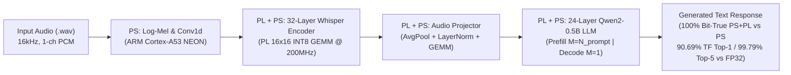
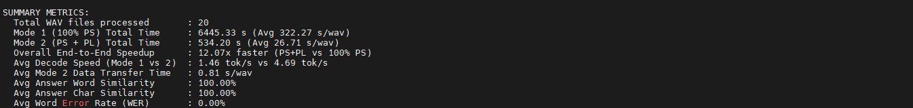
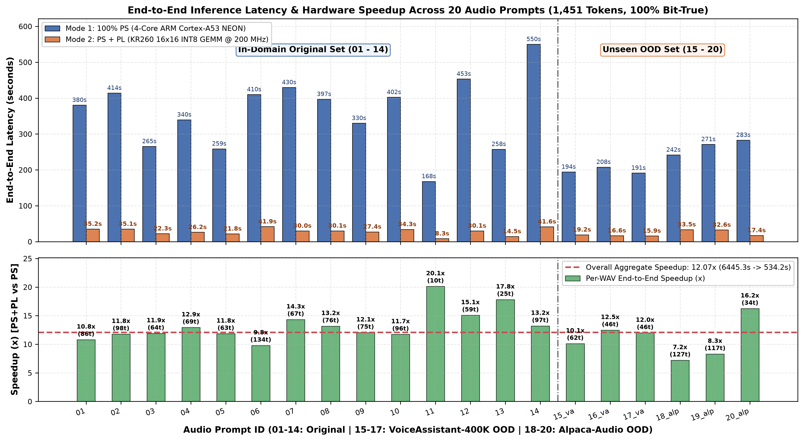
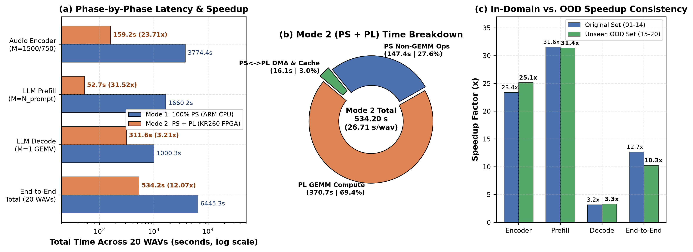
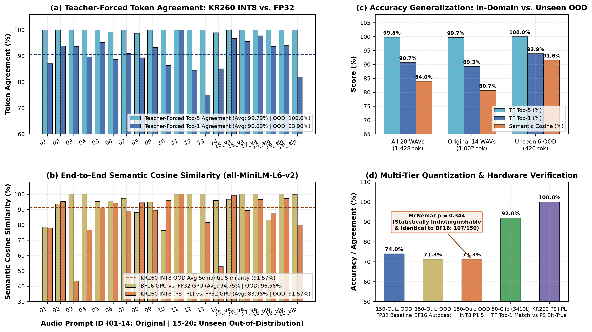
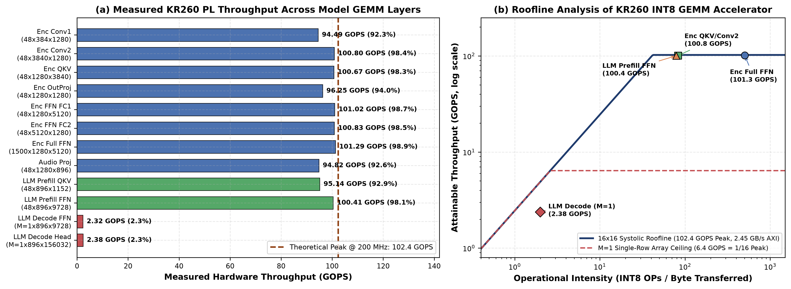
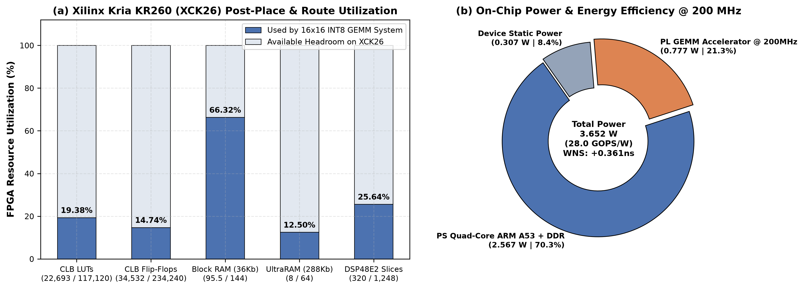

# Qwen2-Audio Dialogue FPGA Accelerator (Xilinx Kria KR260)

An **End-to-End Hardware/Software Co-Design** accelerating the multimodal **Qwen2-Audio Dialogue** model (32-layer Whisper-large Audio Encoder + Audio Projector + 24-layer Qwen2-0.5B LLM) on the **AMD/Xilinx Kria KR260 (Zynq UltraScale+ MPSoC)** platform.

---

## I. Overview

This repository provides a complete edge inference pipeline—from raw audio waveforms (`.wav`) to generated text responses—on the Kria KR260, partitioning execution across the **ARM Cortex-A53 Processing System (PS)** and a custom **200 MHz $16 \times 16$ INT8 GEMM Accelerator in Programmable Logic (PL)**:



### Key System Capabilities
* **Accuracy-Preserving Quantization (`INT8 P1.5` + 3-Digit Outlier Fallback):** Combines offline **SmoothQuant** migration, symmetric **Per-Channel INT8** weight quantization, static activation quantization (`margin = 1.5`), and a dynamic **base-128 3-digit INT8 decomposition** for massive activation outliers (`1.356%` of rows), preserving FP32 semantic accuracy without retraining.
* **Multi-Threaded C++ Runtime & Zero-Copy CMA (`llm_runtime.cpp`):** Executes the full multimodal pipeline in standalone C++ on ARM64 Linux; statically pins all 24 LLM layers and `lm_head` weights in physically contiguous **CMA memory (`/dev/dma_heap/reserved`)** with user-space ARMv8 hardware cache maintenance (`dc cvac` / `dc civac`).
* **NEON-Vectorized Non-Linear PS Kernels:** Parallelizes `Log-Mel Spectrogram`, `LayerNorm`, `RMSNorm`, `RoPE`, `GELU LUT`, `SiLU`, `Attention Softmax`, and `KV-Cache Quantization` across all 4 Cortex-A53 cores using ARMv8 NEON SIMD with pre-allocated static buffers (**zero heap allocation** during token generation).
* **200 MHz PL Systolic Array Acceleration:** Offloads all 41 dense matrix multiplications across the Audio Encoder, Projector, and Qwen2 LLM to the $16 \times 16$ Output-Stationary INT8 GEMM core in PL (peak **102.4 GOPS**) within a **3.652 W** total chip power envelope.

---

## II. Final Results

### 1. Hardware Acceleration & Bit-True Verification on Kria KR260
Evaluated across the 20-query audio benchmark suite (`1,451` generated tokens) comparing **Mode 1 (`100% PS` — 4-thread ARM Cortex-A53 NEON)** against **Mode 2 (`PS + PL` — CPU + 200 MHz FPGA Accelerator)**:

| Evaluation Metric | Mode 1: `100% PS` (CPU) | Mode 2: `PS + PL` (FPGA) | Speedup / Outcome |
| :--- | :---: | :---: | :---: |
| **Output Equivalence (`PS + PL` vs. `100% PS`)** | Baseline | **100% Bit-True** | `WordSim = 100%`, `WER = 0.00%` (20/20 files) |
| **Total Execution Time (20 `.wav` files)** | `6,445.33 s` | **`534.20 s`** | **`12.07x` faster** (overall end-to-end) |
| **Average Latency per `.wav` Query** | `322.27 s / wav` | **`26.71 s / wav`** | **Peak `20.61x` speedup** (`8.26 s` on `11.wav`) |
| **Phase 1: Audio Encoder (32-layer Whisper)** | `188.72 s / wav` | **`7.96 s / wav`** | **`23.71x` faster** (`25.15x` on OOD queries) |
| **Phase 2: LLM Prefill (24-layer Qwen2)** | `83.01 s / wav` | **`2.63 s / wav`** | **`31.52x` faster** |
| **Phase 3: LLM Decode (`M = 1` autoregressive)** | `1.46 tokens/s` | **`4.69 – 5.01 tokens/s`** | **`3.21x` faster** |
| **Sustained PL GEMM Throughput** | `~2.1 – 7.6 GOPS` | **`101.29 GOPS`** | **`98.9%`** of theoretical peak (`102.4 GOPS`) |
| **Total Chip Power & Energy Efficiency** | — | **`3.652 W`** | **`28.0 GOPS / W`** (LUT `19.4%`, DSP `25.6%`, BRAM `66.3%`) |

<p align="center">
  <br>
  <em>On-board execution summary across all 20 <code>.wav</code> queries on Kria KR260: 100% Bit-True match (<code>WER = 0.0%</code>) and <code>12.07x</code> average end-to-end speedup.</em>
</p>

<p align="center">
  
</p>

<p align="center">
  
</p>

---

### 2. Model Quality: `KR260 INT8 P1.5` vs. `PyTorch FP32 / BF16`
End-to-end numerical and semantic comparison between hardware-generated responses on **Kria KR260 (`INT8 P1.5`)** and the unquantized **`PyTorch FP32 / BF16`** baseline on GPU:

| Evaluation Benchmark | Metric | `KR260 INT8` Result | Comparison vs. `FP32` / `BF16` |
| :--- | :--- | :---: | :--- |
| **20-Query Dialogue Suite** *(1,428 tokens)* | Teacher-Forced **Top-1 / Top-5 Agreement** | **`90.69%` / `99.79%`** | 17/20 queries achieve `100.00%` Top-5 agreement |
| **6 Unseen OOD Queries** *(426 tokens)* | Teacher-Forced **Top-1 / Top-5 Agreement** | **`93.90%` / `100.00%`** | **`91.57%` Semantic Cosine Similarity** (near `BF16` at `96.56%`) |
| **50 Calibration Audio Clips** *(3,410 tokens)* | Teacher-Forced **Top-1 Agreement & KL Div** | **`91.96%`** (`KL = 0.0248`) | **`0.0 / 1000`** catastrophic token flips |
| **150-Question OOD Audio Quiz** | Multiple-Choice **Accuracy** | **`107 / 150` (`71.3%`)** | **Identical to `BF16` (`71.3%`)**, statistically indistinguishable from `FP32` (`74.0%`, McNemar $p = 0.344$) |

<p align="center">
  
</p>

<p align="center">
  
  
</p>

*(Detailed per-query evaluations are available in [`BENCHMARK_20WAVS_EVALUATION.md`](results_and_evaluation/evaluation_reports/BENCHMARK_20WAVS_EVALUATION.md) and [`FP32_VS_KR260_INT8_EVALUATION.md`](results_and_evaluation/evaluation_reports/FP32_VS_KR260_INT8_EVALUATION.md)).*

---

## III. Project Structure

```text
qwen2-audio-fpga-accelerator/
├── README.md                                  # System overview, final results, structure & dataset licenses
├── kr260_runtime/                             # C++ Inference Engine & on-board orchestration tools for Kria KR260
│   ├── README.md                              # Layer-level GEMM verification guide & quantization conventions
│   ├── src/
│   │   ├── llm_runtime.cpp                    # Multi-threaded C++ inference engine (Mode 1: PS NEON | Mode 2: PS+PL)
│   │   └── npu_run_case.c                     # Bit-true verification runner for individual model GEMM layers
│   ├── microbenchmarks/
│   │   ├── ps_bench.c                         # CPU NEON kernel profiler for single-token Qwen2-0.5B decode
│   │   ├── npu_mbench.c                       # Hardware latency profiler across batch/sequence sizes M (1..16)
│   │   └── overlap_bench.c                    # Weight-loading and PL-compute double-buffering benchmark
│   └── scripts/
│       ├── benchmark_ps_vs_pl.py              # Automated 20-WAV benchmark comparing Mode 1 (PS) vs. Mode 2 (PS+PL)
│       ├── run_all_functions.py               # Automated bit-true verifier across all 41 model GEMM shapes
│       ├── bench_cpu_fp32.py                  # Baseline CPU FP32 matrix multiplication benchmark
│       ├── qffn_common.py                     # Bit-accurate Python reference model for FFN & GELU LUT
│       ├── kr260_check.sh                     # System diagnostics, bitstream loader & test runner script
│       ├── run.sh                             # Linux FPGA Manager bitstream loader
│       └── run_wav_set.sh                     # Batch audio evaluation script
├── model_and_dataset/                         # Audio evaluation dataset & PyTorch baseline script
│   ├── LLM_Question/                          # 20 test audio files in 16kHz mono PCM (01.wav -> 20_alpacaaudio.wav)
│   └── test_dialogue_inthewild.py             # PyTorch FP32/BF16 baseline inference script for the 20 WAV queries
├── quantization_notebooks/                    # INT8 P1.5 quantization, pkg_v1 export & quality verification notebooks
│   ├── export_and_sim/
│   │   ├── qwen2audio_int8_export_colab.ipynb # Exports quantized weights and scales into the pkg_v1 binary package
│   │   ├── ref_run_pkg.ipynb                  # Bit-accurate simulation notebook for pkg_v1
│   │   ├── ref_runtime.py                     # Python reference runtime implementation
│   │   └── make_cpp_inputs.py                 # Input generator for the C++ runtime
│   └── quality_evaluation/
│       ├── qwen2audio_int8_quality_150wav_colab.ipynb  # INT8 P1.5 calibration & 150-question OOD Audio Quiz evaluation
│       ├── qwen2-audio-int8_quality_50wav_kaggle.ipynb # Quantization quality evaluation across 50 audio clips
│       ├── kr260_int8_vs_fp32_20wavs_colab.ipynb       # End-to-end comparison: KR260 INT8 vs. PyTorch FP32/BF16 (20 WAVs)
│       └── more-wav-forqwen2.ipynb                     # Extraction & 16kHz normalization of the 6 OOD audio files (15..20)
└── results_and_evaluation/                    # Final evaluation reports, publication figures & on-board screenshots
    ├── evaluation_reports/
    │   ├── BENCHMARK_20WAVS_EVALUATION.md     # Detailed evaluation of Mode 1 (100% PS) vs. Mode 2 (PS + PL)
    │   ├── FP32_VS_KR260_INT8_EVALUATION.md   # Detailed evaluation of PyTorch FP32/BF16 vs. KR260 INT8
    │   ├── generate_evaluation_figures.py     # Script generating 300 DPI PNG & Vector PDF evaluation plots
    │   └── figures/                           # 5 publication-ready figures (fig1..fig5 in .png & .pdf)
    └── board_screenshots/                     # 7 terminal screenshots captured during live execution on Kria KR260
```

---

## IV. Sources & Dataset Licenses

### 1. Hardware IP, Model Baseline & Analysis Links
| Component | Resource / Link | Description |
| :--- | :--- | :--- |
| **PL Hardware IP & Low-Level Drivers** | [`int8-matmul-accelerator`](https://github.com/VuDaiDuong-325/int8-matmul-accelerator) | Verilog RTL source (`16x16` Systolic Array, L2 Tiling AGU, Requant), Vivado Block Design, Testbenches, NPU drivers (`kr260_npu_driver.h`, `npu_driver.h`), and hardware probes (`gemm_test.c`, `ddr_bench.c`, `dmaheap_probe.c`, `cma_probe.c`, `regver.c`). |
| **Target Model Baseline (GitHub)** | [`tranquangchung/Audio_Speech_Conversation`](https://github.com/tranquangchung/Audio_Speech_Conversation) | Upstream Qwen2-Audio architecture (`models/`), original 14 `.wav` files (`01.wav`–`14.wav`), and `test_dialogue_inthewild.py`. |
| **Model Checkpoint (Hugging Face)** | [`tranquangchung/qwen2-audio-dialogue`](https://huggingface.co/tranquangchung/qwen2-audio-dialogue) | Fine-tuned Qwen2-Audio Dialogue checkpoint (32-layer Whisper-large Audio Tower + Projector + 24-layer Qwen2-0.5B, `~5.1 GB` FP32). |
| **Quantization & Verification Analysis (Kaggle)** | [`duynguynngphng/qwen2-analysis`](https://www.kaggle.com/code/duynguynngphng/qwen2-analysis) | Detailed analysis of INT8 quantization error, activation/weight distributions, and accuracy verification on Qwen2-Audio. |

### 2. Audio Evaluation Datasets & Licenses (`LLM_Question/*.wav`)
The 20 audio test files (`16 kHz`, mono, `16-bit PCM`) in [`model_and_dataset/LLM_Question/`](model_and_dataset/LLM_Question/) consist of 14 in-domain samples (`01.wav`–`14.wav` from `tranquangchung/Audio_Speech_Conversation`) and 6 Out-of-Distribution (OOD) samples (`15`–`20`) curated from open datasets:

* **`gpt-omni/VoiceAssistant-400K` (Mini-Omni)** — *Samples `15_voiceassistant.wav` to `17_voiceassistant.wav`*:
  * **Source:** [Hugging Face Dataset](https://huggingface.co/datasets/gpt-omni/VoiceAssistant-400K) | [GitHub (`gpt-omni/mini-omni`)](https://github.com/gpt-omni/mini-omni)
  * **License:** **Apache License 2.0 (`apache-2.0`)** — Permits free use, modification (resampling to 16 kHz, 1-ch, 16-bit PCM), and public redistribution with attribution.
* **`AudioLLMs/alpaca_audio_test` (AudioBench)** — *Samples `18_alpacaaudio.wav` to `20_alpacaaudio.wav`*:
  * **Source:** [Hugging Face Dataset](https://huggingface.co/datasets/AudioLLMs/alpaca_audio_test) | [GitHub (`AudioLLMs/AudioBench`)](https://github.com/AudioLLMs/AudioBench) | [Upstream (`tatsu-lab/alpaca`)](https://huggingface.co/datasets/tatsu-lab/alpaca)
  * **License:** **Apache License 2.0** (*AudioBench framework*) & **CC BY-NC 4.0** (*Stanford Alpaca*) — Permits modification and public redistribution for academic and non-commercial research.

---

*Project by:*
* **Nguyen Dang Phuong Duy** - [DuyNDP](https://github.com/DuyNDP)
* **Vu Dai Duong** - [VuDaiDuong_325](https://github.com/VuDaiDuong-325)
